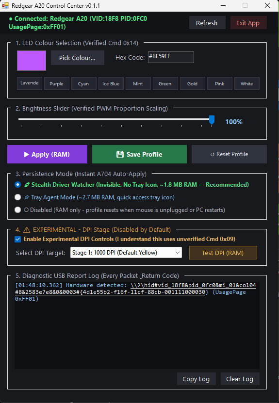

# Redgear A20 Control Center

[](https://github.com/shivamvcx/A20-Driver/releases)
[](LICENSE)
[-0078D6.svg)](https://microsoft.com)
[](src/Program.cs)
[](#build-from-source)
[-success.svg)](#disclaimer)

**Open-source Redgear A20 software for Windows** — a lightweight replacement for the official Redgear A20 gaming mouse driver. Control **RGB lighting, brightness, DPI, button remapping and keyboard shortcuts** from a single portable `.exe`: no installer, no background services, no telemetry.

It talks directly to the **Redgear A20 RGB Gaming Mouse** (`VID: 0x18F8 & PID: 0x0FC0`) and its Instant A704 microcontroller over USB HID Feature Reports.

> **Latest version: [v0.3.0](https://github.com/shivamvcx/A20-Driver/releases/latest)** — adds Button Remapping and Keyboard Shortcuts.
>
> **Next: v0.4.0** — complete UI redesign ([see plans](#whats-next-v040)).

<p align="center">
  
</p>

## Key Features

- **True 12-bit RGB control** — 4,096 colors via reverse-engineered active-low PWM registers, with a visual picker, `#RRGGBB` hex input, and quick presets.
- **Solid static mode** — hardware mode `0x86` permanently replaces the stock, unchangeable rainbow breathing cycle.
- **Proportional brightness dimming** — 5–100% scaling that preserves the exact color hue.
- **Experimental DPI stage control** — select among 600–3200 DPI stages (opt-in and RAM-tested before saving).
- **Button remapping** — reassign Middle / Wheel, Forward, Back, DPI + and DPI − to clicks, DPI controls, Double Click, Rapid Fire, Show Desktop or Disabled. Test on the mouse before saving; Left / Right Click stay locked so the mouse can never become unusable.
- **Keyboard shortcuts on mouse buttons** — bind any remappable button to a key combo (e.g. `Ctrl + C`, `Alt + Tab`, `F5`). The mouse types it as its own USB keyboard — no global keyboard hooks. Ctrl + Alt + Del is blocked and risky combos ask for confirmation.
- **Stealth persistence** — a hidden background watcher (~1.8 MB RAM, 0% CPU, no tray clutter) detects USB hotplugs via native `WM_DEVICECHANGE` and restores your settings in ~300 ms, across reboots, sleep cycles, and any USB port. Three modes: Stealth Watcher, Tray Agent, or RAM-only.
- **Safety-first engineering** — RAM-only application, mandatory 50 ms inter-packet pacing, atomic profile writes, global crash logging, and automatic disconnect recovery.
- **Live diagnostic console** — every 8-byte feature report with its Win32 return status, copyable to clipboard.
- **Native modern UI** — immersive dark title bar, Per-Monitor V2 DPI awareness, and crisp 4K rendering in a ~109 KB binary.

## Quick Start

1. Download the latest `RedgearA20-win-x64.exe` from [Releases](https://github.com/shivamvcx/A20-Driver/releases).
2. Plug in your Redgear A20 and double-click the executable — no installation required.
3. Confirm the status bar shows `● Connected: Redgear A20 (VID:18F8 PID:0FC0 UsagePage:0xFF01)`.
4. Pick a color and brightness.
5. Under **Persistence Mode**, select **Stealth Driver Watcher**, then click **Save Profile**.
6. Close the window. Your settings now persist silently across reboots and USB replugs.
7. *(Optional)* Open the **Button Mapper** to remap buttons or assign keyboard shortcuts. Shortcuts need the app running in the background, so keep **Stealth Watcher** or **Tray Agent** enabled.

## How Persistence Works

The A704 chip has no non-volatile storage for user settings — custom registers live in volatile SRAM and reset to factory defaults the moment USB power drops. The original vendor software worked around this with a bloated background service; this project solves it with a featherweight hidden watcher that reapplies your profile the instant the mouse reappears on the bus.

## USB Protocol

All communication uses 8-byte HID Feature Reports on the vendor endpoint `UsagePage 0xFF01` (Report ID `0x07`):

| Command | Purpose | Status |
| :---: | :--- | :---: |
| `0x14` | Per-stage RGB color (4-bit active-low PWM) | Verified |
| `0x13` | LED mode — `0x86` static, `0x87` off, breathing, spectrum | Verified |
| `0x20` | Hardware register sync latch | Verified |
| `0x09` | DPI stage & enabled-stage bitmask | Experimental |
| `0x10` | Button remapping (per-button action code) | Verified |
| `0x15` | Keyboard key injection (shortcut playback) | Verified |
| `0x16` | Extended button matrix | Research |

## What's Next: v0.4.0

v0.4.0 is a **complete UI redesign** — a modern device panel with a large mouse preview, tab navigation (Lighting · DPI · Buttons · Settings), toggle switches, rounded sliders and a built-in Button Mapper tab. All existing features and saved profiles carry over, and it stays a single lightweight portable file. Development happens on the [`UI-refactor`](https://github.com/shivamvcx/A20-Driver/tree/UI-refactor) branch.

## Roadmap

| Version | Scope | Status |
| :---: | :--- | :---: |
| v0.1.0 – v0.2.1 | RGB engine, stealth persistence, industrial UI overhaul, stability hardening | Released |
| v0.3.0 | Hardware button remapping + keyboard shortcuts on mouse buttons | Released |
| v0.4.0 | Complete UI redesign (tabbed layout, modern controls, built-in Button Mapper) | In progress |
| Future | Extended RGB effects, sensor & polling rate, per-stage DPI customization, sniper mode | Planned |
| v1.0.0 | Stable release + multi-device OEM support | Long-term |

## Build from Source

No Visual Studio, SDK, or toolchain installation required — the project compiles with Windows' built-in C# compiler:

```cmd
git clone https://github.com/shivamvcx/A20-Driver
cd A20-Driver
build.bat
```

Output lands in `release\`: `RedgearA20-win-x64.exe` plus its SHA-256 checksum.

## Supporting Other Mice

Community contributions for other OEM mice (Instant Microelectronics, SinoWealth, or Holtek chipsets) are welcome. Open an issue with your device's `VID`/`PID`, its USB HID report descriptor, and packet captures recorded against the original vendor software.

## Disclaimer

> **This is an independent, unofficial community project.** It is not affiliated with, endorsed by, sponsored by, or associated with Redgear or Imagine Marketing Limited. All trademarks belong to their respective owners.
>
> This software communicates directly with mouse hardware using reverse-engineered USB HID feature reports. While it is built with strict safety guardrails (RAM-only application, mandatory inter-packet delays, decoupled save operations), **use this software at your own risk**.

## Author

**Shivam** ([@shivamvcx](https://github.com/shivamvcx)) — reverse-engineered the USB protocol, validated every packet and guardrail on physical hardware, and used AI coding agents for implementation acceleration and documentation. Everything was reviewed, debugged, and verified against the real device.

## License

This project is licensed under the **GNU General Public License v3.0** — see the [LICENSE](LICENSE) file for details.
