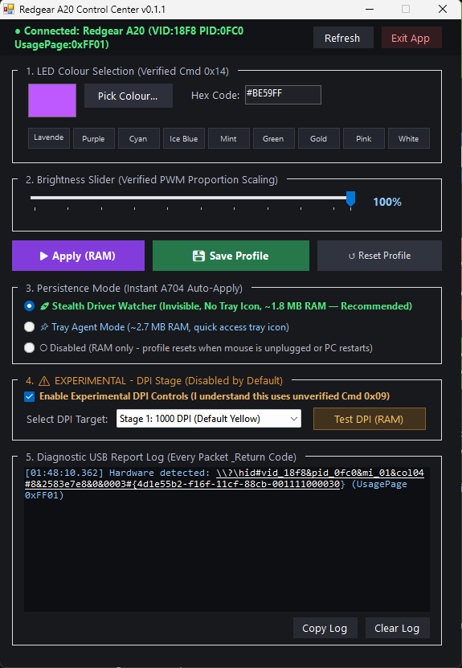

# Redgear A20 Control Center

[](https://github.com/shivamvcx/A20-Driver/releases)
[](LICENSE)
[-0078D6.svg)](https://microsoft.com)
[](src/Program.cs)
[](#download--quick-start)
[-success.svg)](#system--hardware-compatibility)

A standalone, zero-bloat, open-source Windows driver and hardware control application for the **Redgear A20 RGB Gaming Mouse** (`VID: 0x18F8 & PID: 0x0FC0`).

I engineered this project single-handedly to replace the abandoned, malfunctioning official vendor software with a clean, high-performance desktop utility that unlocks true 12-bit RGB lighting control, eliminates unwanted rainbow breathing, and communicates directly with mouse hardware without background services or telemetry.

<p align="center">
  
</p>

---

## Disclaimer

> **This is an independent, unofficial community project.** It is not affiliated with, endorsed by, sponsored by, or associated with **Redgear** or **Imagine Marketing Limited**. All trademarks and brand names belong to their respective owners.
> 
> This software interacts directly with mouse hardware using reverse-engineered USB HID Feature Reports. While it has been designed with strict safety guardrails (RAM-only application, mandatory hardware delays, decoupled flash writes), **use this software at your own risk**.

---

## System & Hardware Compatibility

* **Supported Mouse**: **Redgear A20 RGB Gaming Mouse** (Instant Microelectronics OEM chipset, `VID: 0x18F8`, `PID: 0x0FC0`).
  *(Other mice are not supported in this release; see [Adding Support for Other Mice](#adding-support-for-other-mice)).*
* **Supported Operating System**: **Windows 10 / Windows 11 (64-bit)**.
* **Dependencies**: **None**. Built with standard .NET Framework 4.8 Windows Forms; runs on any standard Windows installation out-of-the-box.

---

## Key Features (v0.2.0 Release)

* **Industrial Precision Utility UI & Windows 10/11 Dark Title Bar**:
  - **Native Dark Window Title Bar**: Integrated `dwmapi.dll` P/Invoke (`DWMWA_USE_IMMERSIVE_DARK_MODE`) ensuring the OS title bar renders in immersive dark mode instead of standard bright white.
  - **Zero-Allocation GDI+ Token Engine**: Pre-cached brushes, pens, and system typography (`Theme` class) guaranteeing smooth rendering without garbage collection stutter during paint events.
  - **Clean Hairline Card Architecture**: Replaced generic WinForms GroupBoxes with 1px hairline card containers (`CreateSectionPanel`), visual preset borders, unified 36px action row, and clear visual hierarchy with an Emerald (`#10B981`) primary accent.
  - **Per-Monitor V2 High-DPI Scaling & Common Controls v6**: Embedded native application manifest (`src/app.manifest`) delivering crisp, sharp rendering across modern 4K multi-monitor setups without bitmap blur.
* **Stealth Driver Watcher (Near-Zero RAM Persistence)**:
  - **Zero Taskbar & Zero System Tray Clutter**: Runs as an invisible background watcher (`trayIcon.Visible = false`) with no taskbar button and no tray icons cluttering your screen.
  - **Ultra-Low Memory Footprint**: Uses `SetProcessWorkingSetSize` P/Invoke to aggressively compress working set memory to **~1.8 MB RAM** and **0.00% CPU** when idle.
  - **Instant Hotplug Persistence Across All Ports**: Intercepts native Win32 `WM_DEVICECHANGE` window messages in `< 50ms`. Custom color and DPI are restored in `~300ms` when unplugging, replugging, or switching USB ports.
  - **Cold-Boot & Sleep Persistence**: Starts silently on Windows login via `HKCU\Software\Microsoft\Windows\CurrentVersion\Run`. Survives system reboots and Modern Standby / S3 sleep.
  - **Single-Instance IPC with UIPI Traversal**: Re-launching the `.exe` wakes the existing GUI without spawning duplicate background processes. Closing via the Windows Close `[X]` button keeps your settings auto-applying silently in the background. An explicit **Exit App** button (with confirmation) is provided to completely terminate the background watcher.
  - **3 Persistence Modes**:
    1. **Stealth Driver Watcher**: Invisible, no tray icon, ~1.8 MB RAM (Recommended)
    2. **Tray Agent Mode**: ~2.7 MB RAM, quick-access system tray icon
    3. **Disabled**: RAM only, reverts to default when mouse is unplugged
* **4,096-Color True Precision Engine**:
  - Full 12-bit RGB color control ($16 \times 16 \times 16$ levels per channel).
  - Uses verified **Active-Low PWM** register mapping ($0 = 100\%$ ON, $15 = 0\%$ OFF).
  - Visual Color Dialog picker + custom Hex code input (`#RRGGBB`) with strict sanitization and validation.
  - Quick presets: *Lavender, Purple, Cyan, Ice Blue, Mint, Green, Gold, Pink, White*.
* **Proportional PWM Brightness Dimming**:
  - Variable brightness slider ($5\text{–}100\%$) that scales channel duty cycles proportionally while preserving the exact color hue.
* **Solid Static Mode (No Breathing)**:
  - Hardware mode `0x86` forces the microcontroller to display permanent, non-fading solid light, eliminating the default unchangeable rainbow breathing cycle.
* **Experimental DPI Stage Controls & Asynchronous Mutex Dispatch**:
  - Optional toggle for Command `0x09` allowing selection of active DPI stages (Stage 0: 600, Stage 1: 1000, Stage 2: 1200, Stage 3: 1600, Stage 4: 2400, Stage 5: 3200 DPI).
  - Multi-threaded background execution (`Task.Run` with `async`/`await`) ensures UI never freezes while waiting for hardware mutex acquisition.
* **Hardened Safety Architecture & Fault Tolerance**:
  - **Resilient Atomic Profile Serialization**: Uses temporary file replacement (`File.Replace`) with UTF-8 encoding to prevent profile corruption during abrupt shutdowns.
  - **Dynamic Disconnect Recovery**: Automatically detects cable disconnects (Win32 errors 1167, 2, 6), invalidates stale device handles, and displays red status alert.
  - **Hotplug Re-Entrancy Guard**: Prevents overlapping recovery sweeps during rapid USB reconnection.
  - **Global Crash Diagnostics**: Automatically logs unhandled exceptions to `%LocalAppData%\RedgearA20\crash.log`.
  - **Non-Destructive Device Enumeration**: Uses query access mode `0` during device discovery to eliminate handle sharing conflicts.
  - **Apply to RAM Only**: Changes can be tested in volatile memory first (`Apply (RAM)`).
  - **Local Profile Persistence**: Auto-deploys to `%LocalAppData%\RedgearA20\RedgearA20.exe` so you can move or delete the downloaded file without breaking persistence.
  - **Factory Profile Reset**: Restores stock multi-stage DPI colors (Blue, Yellow, Green, Purple, Cyan, White) and default breathing cycle mode.
  - **Asynchronous Execution & UI Locking**: Background worker execution prevents GUI stuttering; locks UI controls during transmission.
  - **Post-Write Health Check**: Interrogates `HidD_GetFeature` to verify microcontroller responsiveness.
  - **Zero Slider Spamming**: Sliders only update local UI preview; zero USB packets transmitted while dragging.
  - **Mandatory 50ms Delays**: Safe inter-packet delay prevents 8-bit MCU buffer overruns.
* **Live Monospace Diagnostic Log**:
  - Embedded console displaying every 8-byte Feature Report sent and its Win32 return status, with one-click clipboard export.
* **Ultra-Light Portable Executable**:
  - Standalone $\approx 70\text{ KB}$ 64-bit executable (`RedgearA20-win-x64.exe`). Zero dependencies, zero installer, zero electron wrappers.

---

## Hardware Architecture: Instant A704

Through reverse engineering and disassembling the vendor's `Gaming Mouse 2.0.exe`, I discovered a critical hardware reality:
- The **Instant Microelectronics A704 / A704F IC** physically lacks non-volatile EEPROM/Flash storage for custom RGB lighting. Custom lighting registers are held in volatile SRAM, which wipes whenever power is lost (PC shutdown or USB unplug).
- The official Redgear software worked around this by leaving a bloated background service running.
- **Redgear A20 Control Center replaces that bloat** with a featherweight **Stealth Driver Watcher** (~1.8 MB RAM, 0% CPU, no tray icon) that detects USB hotplug in real-time via Win32 `WM_DEVICECHANGE` and restores your profile instantly.

---

## Protocol Reference

All hardware communication is performed via 8-byte USB HID Feature Reports sent to endpoint **UsagePage `0xFF01` (Report ID `0x07`)**:

```
Packet Structure: [0x07, Command, Param1, Param2, Param3, Param4, Param5, Param6]
```

| Command | Target | Payload Format | Description | Status |
| :---: | :---: | :--- | :--- | :---: |
| **`0x14`** | DPI Stage RGB | `[07 14 (Stage<<5)\|Green_Inv (Red_Inv<<4)\|Blue_Inv 00 00 00 00]` | 4-bit Active-Low PWM color per stage | Verified |
| **`0x13`** | LED Mode | `[07 13 7F ModeByte 00 00 00 00]` | `0x86` = Solid Static, `0x80` = Breathing, `0x87` = Off | Verified |
| **`0x09`** | Sensor DPI | `[07 09 (0x40\|Stage) 08 EnabledMask 00 00 00]` | Active stage & 6-bit enabled mask | Experimental |
| **`0x20`** | Sync Latch | `[07 20 00 00 00 00 00 00]` | MCU register synchronization latch | Verified |

> **Project Documentation & Technical Guides**:
> - [Architecture & Guardrails](docs/architecture-decisions-and-guardrails.md) — Core architectural decisions, hardware reality, and strict developer guardrails.
> - [Design System Tokens](docs/design-tokens.md) — Visual design tokens, GDI+ rendering rules, and palette hierarchy.
> - [Product Specification](docs/product-spec.md) — Target audience, hardware positioning, constraints, and commitments.
> - [Protocol Specification](docs/protocol-notes.md) — Complete byte-by-byte register and command reference.
> - [Feature Roadmap](docs/roadmap.md) — Upcoming milestones, planned RGB effects, and sensor tuning.
> - [Feature Masterlist (v10.0.0)](docs/features-masterlist.md) — Comprehensive long-term end-state feature specification.
> - [Engineering DevLog](docs/devlog.md) — Technical story, reverse-engineering breakthrough, and safety architecture.
> - [Changelog](docs/changelog.md) — Version release notes and migration history.

---

## Download & Quick Start

No installer or runtime dependencies required. It is a portable standalone utility for 64-bit Windows 10 and 11.

1. **[Download Latest Release (`RedgearA20-win-x64.exe`)](https://github.com/shivamvcx/A20-Driver/releases)** from the GitHub Releases page.
2. Plug in your **Redgear A20** mouse into any USB port.
3. Double-click **`RedgearA20-win-x64.exe`** to launch.
4. Verify the top status bar confirms:
   `● Connected: Redgear A20 (VID:18F8 PID:0FC0 UsagePage:0xFF01)`
5. Pick your color using the visual picker or type a custom `#RRGGBB` hex code (e.g. Lavender `#BE59FF`) and adjust brightness.
6. Under **Section 3 (Persistence Mode)**, select **`Stealth Driver Watcher`** and click **`[ Save Profile ]`**.
7. Close the window (`[X]`).
   - The window closes and **no system tray icon appears**.
   - Your mouse will now permanently keep your custom color across all reboots, laptop sleep/wake, and physical USB replugs into any port!

---

## Build from Source

If you prefer to audit the source code and compile the standalone executable yourself:

> **Note**: This project compiles directly using Microsoft's built-in C# compiler (`csc.exe`) included with Windows. **No Visual Studio, SDK, or toolchain installation is needed.**

1. Clone the repository:
   ```cmd
   git clone https://github.com/shivamvcx/A20-Driver.git
   cd A20-Driver
   ```
2. Run the 1-click build script:
   ```cmd
   build.bat
   ```
3. The executable and SHA256 checksum will be generated in `release\`:
   - `release\RedgearA20-win-x64.exe`
   - `release\RedgearA20-win-x64.sha256`

---

## Adding Support for Other Mice

If you have a different budget or OEM gaming mouse (e.g., mice powered by Instant Microelectronics, SinoWealth, or Holtek chips) that suffers from broken vendor software, community contributions are welcome!

To request support or contribute a profile, please open an Issue with:
1. **Device Identification**:
   - Vendor ID (`VID`) and Product ID (`PID`) (found in Windows Device Manager $\rightarrow$ Mice $\rightarrow$ Hardware IDs).
2. **USB HID Report Descriptor**:
   - Exported using tools like `USBlyzer`, `Wireshark` with `USBPcap`, or `node-hid`.
3. **Packet Captures**:
   - USB packet capture (`.pcapng`) recorded while clicking buttons or applying colors in the original vendor software.

---

## Author & Background

Hey, I'm **[Shivam](https://github.com/shivamvcx)** ([@shivamvcx](https://github.com/shivamvcx)). I single-handedly built and reverse-engineered this project as an independent open-source passion project under my personal development lab, **[Silicon Labs](https://siliconlabs.vercel.app/)**.

I got tired of the abandoned, buggy official OEM software constantly wiping my mouse's RGB settings on every reboot or USB replug, so I sat down, reverse-engineered the USB HID communication protocol from scratch, and wrote a clean, lightweight driver utility for myself and anyone else using the Redgear A20.

---

## License

This project is licensed under the **MIT License**. See the [LICENSE](LICENSE) file for details.
