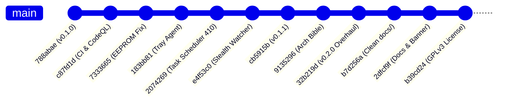

# 📘 Redgear A20 Control Center: Master Project Context & Hardware Knowledge Base

> **PRIMARY REPOSITORY**: [https://github.com/shivamvcx/A20-Driver](https://github.com/shivamvcx/A20-Driver)  
> **TARGET HARDWARE**: Redgear A20 RGB Gaming Mouse (`VID: 0x18F8`, `PID: 0x0FC0`)  
> **CHIPSET**: Instant Microelectronics A704 / A704F USB Optical Gaming Mouse IC  
> **LAST UPDATED**: October 2026 (Milestone v0.2.0 Hardening & Licensing)  
> **PROJECT STATUS**: Production Hardened, Standalone Zero-Dependency Win32 Utility  

---

> [!IMPORTANT]
> ### 🚨 MANDATORY INSTRUCTION FOR INCOMING AI MODELS (GLM 5.3, Fable 5, Opus 5.5, etc.)
> 
> Before proposing code modifications, adding new features, or refactoring this repository, **YOU MUST REVIEW THE OFFICIAL GITHUB REPOSITORY**:
> **👉 [https://github.com/shivamvcx/A20-Driver](https://github.com/shivamvcx/A20-Driver)**
> 
> Check the GitHub repository for:
> 1. Complete commit history, release tags, and pre-compiled releases.
> 2. Issues, discussions, and reported hardware quirks.
> 3. Visual assets, UI designs, and architectural decision documents (`docs/`).
> 
> **DO NOT** attempt to re-invent reverse-engineering findings, guess opcodes, remove safety delays, or introduce heavy third-party dependencies (NuGet, Electron, Python, C++ runtimes). Everything discovered through reverse engineering, firmware disassembly, and silicon testing is documented in this context file.

---

## 1. Project Mission & Sacred Architectural Pillars

The **Redgear A20 Control Center** replaces the abandoned, bloated, and malfunctioning proprietary software (`Gaming Mouse 2.0.exe`) with a clean, high-performance, open-source utility inspired by **Logitech Onboard Memory Manager (OMM)** and **OpenRGB**.

### The Three Sacred Pillars:
1. **Zero External Dependencies**:
   - Standalone single executable compiled directly with Windows' built-in .NET Framework C# compiler (`csc.exe`).
   - **No Visual Studio required**, no NuGet packages (`Newtonsoft.Json`, `HidLibrary`, etc.), no Electron, no WebView2, no Python runtime.
   - Runs out-of-the-box on clean installations of Windows 10 & 11 (64-bit).
2. **Hardware Safety Above All**:
   - Budget 8-bit microcontrollers (Instant A704) are prone to GPIO starvation and buffer locks.
   - All experimental features are isolated behind opt-in guards and tested in volatile RAM before committing.
   - Mandatory inter-packet delays and ephemeral file handles are strictly enforced.
3. **True Background Stealth (< 2 MB RAM, 0% CPU)**:
   - When background persistence is needed to compensate for hardware silicon limitations, it operates completely invisibly (no tray clutter, no taskbar button, ~1.8 MB compressed working set, 0.00% idle CPU).

---

## 2. Commit History & Versions Released

The project has achieved the following version milestones on GitHub:



### Milestone Breakdown:

#### 🏷️ `v0.1.0` (Initial Release — Commit `788abae`)
- Initial release of Redgear A20 Control Center in C# Windows Forms.
- Disassembled `Gaming Mouse 2.0.exe` and mapped primary HID Feature Reports.
- Breakthrough discovery of 12-bit Active-Low PWM registers (Command `0x14`).
- Implemented solid static lighting (Command `0x13` Mode `0x86`), solving the forced rainbow breathing bug.
- Pure Win32 P/Invoke HID transport (`hid.dll`, `setupapi.dll`).
- 1-click build pipeline (`build.bat`) with built-in `csc.exe` (~25 KB executable).

#### 🏷️ `v0.1.1` (Persistence Overhaul & Stealth Watcher — Commit `cb5915b`)
- Forensic hardware discovery: Instant A704 lacks non-volatile EEPROM for custom RGB; Command `0x20` is a volatile SRAM sync latch.
- Post-Mortem on Task Scheduler Event 410: Windows kernel suppresses `winevt` logging on normal USB hotplug, rendering event triggers unviable.
- Created the **Stealth Driver Watcher**: native Win32 `WM_DEVICECHANGE` listener, working set memory trimming via `SetProcessWorkingSetSize` (~1.8 MB RAM, 0% CPU).
- Single-Instance Mutex with cross-session UIPI bypass (`ChangeWindowMessageFilter`).
- Accidental exit safeguards and prominent exit confirmation warnings.

#### 🏷️ `v0.2.0` (Industrial UI Overhaul & Hardening — Commit `32b219d` to `b39cd24`)
- **Visual Overhaul**: Industrial Precision Utility design language (Emerald `#10B981` accent, 1px hairline card borders, custom preset borders, dark surfaces).
- **Zero-Allocation GDI+**: Pre-cached brushes, pens, and fonts in `Theme` static class to eliminate GC stutter during paint.
- **Native Immersive Dark Title Bar**: Win32 `dwmapi.dll` P/Invoke (`DWMWA_USE_IMMERSIVE_DARK_MODE` 20/19).
- **Per-Monitor V2 DPI & Manifest**: Created `src/app.manifest` declaring Windows 7–11 compatibility, Common Controls v6, and Per-Monitor V2 DPI awareness.
- **Asynchronous Hardware Mutex**: Offloaded hardware locking and experimental DPI testing to background tasks (`Task.Run` with `async`/`await`).
- **Non-Destructive Enumeration**: Changed device search access mode to `0` (query only) to prevent sharing violations.
- **Dynamic Disconnect Recovery**: Automated handle invalidation on Win32 errors `1167`, `2`, `6` with instant red UI status warning.
- **Atomic Profile Storage**: Temporary file write (`.tmp`) with atomic commit via `File.Replace` / `File.Move`.
- **Global Crash Diagnostics**: Global exception traps writing to `%LocalAppData%\RedgearA20\crash.log`.
- **License**: Changed repository license from MIT to **GNU General Public License v3.0 (GPLv3)** (Commit `b39cd24`).

---

## 3. Hardware Reverse Engineering & Protocol Specification

### 3.1. Physical Device & Interface Architecture
* **Vendor ID (VID)**: `0x18F8` (Instant Microelectronics OEM)
* **Product ID (PID)**: `0x0FC0` ("USB GAMING MOUSE")
* **Target Endpoint**: Vendor-defined Collection **Col04** (`UsagePage 0xFF01`, `Usage 0x0001`)
* **Fallback Endpoint**: Vendor-defined Collection **Col03** (`UsagePage 0xFF00`, `Usage 0x0001`)
* **Communication Mechanism**: USB HID Feature Reports via `HidD_SetFeature`
* **Report ID**: Always `0x07` (Byte 0)
* **Report Size**: Exactly 8 Bytes

```
Standard 8-Byte Feature Report Frame:
[ Byte 0 ] : Report ID (Constant 0x07)
[ Byte 1 ] : Command Opcode (0x09, 0x10, 0x11, 0x12, 0x13, 0x14, 0x15, 0x16, 0x20)
[ Byte 2 ] : Parameter 1
[ Byte 3 ] : Parameter 2
[ Byte 4 ] : Parameter 3
[ Byte 5 ] : Parameter 4
[ Byte 6 ] : Parameter 5
[ Byte 7 ] : Parameter 6
```

---

### 3.2. Complete Command & Opcode Reference Table

Derived directly from disassembly of vendor binary `Gaming Mouse 2.0.exe` (Virtual Addresses `0x00408700` – `0x00408A50`, dispatch buffer at `0x005C1900`):

| Opcode | Disassembly VA | Status | Functional Role & Payload Structure |
|:---:|:---:|:---:|---|
| **`0x14`** | `0x004089CE` | **Verified** | **DPI Stage RGB Colors (4-bit Active-Low PWM)**<br>`[0x07, 0x14, Byte2, Byte3, 0x00, 0x00, 0x00, 0x00]`<br>• Byte 2: `(StageIndex << 5) \| (Green_Inv & 0x0F)`<br>• Byte 3: `((Red_Inv & 0x0F) << 4) \| (Blue_Inv & 0x0F)`<br>• Transmitted across 6 stages (0 to 5) with 50ms pacing. |
| **`0x13`** | `0x004088B0` | **Verified** | **LED Lighting Mode & Cycle Speed**<br>`[0x07, 0x13, Byte2, ModeByte, 0x00, 0x00, 0x00, 0x00]`<br>• Byte 2: Allowed colors bitmask (`0x7F` = all 7 enabled)<br>• Byte 3: Mode Byte:<br>&nbsp;&nbsp;- `0x86`: **Solid Static Mode** (Steady, zero breathing)<br>&nbsp;&nbsp;- `0x80 \| Speed`: **Breathing Mode** (`Speed`: 0=Slow to 5=Fast)<br>&nbsp;&nbsp;- `0x90 \| Speed`: **Spectrum Cycle Mode** (Rainbow)<br>&nbsp;&nbsp;- `0x87`: **LED Off** (Complete darkness) |
| **`0x20`** | `0x004063A2` | **Verified** | **Hardware Register Synchronization Latch**<br>`[0x07, 0x20, 0x00, 0x00, 0x00, 0x00, 0x00, 0x00]`<br>• Signals MCU state machine to latch active RAM registers into live PWM drivers.<br>• *Note*: Custom RGB is held in volatile SRAM; resets to ROM on USB power loss. |
| **`0x09`** | `0x00408938` | **Experimental** | **Sensor DPI Mode & Stage Bitmask**<br>`[0x07, 0x09, Byte2, 0x08, Byte4, 0x00, 0x00, 0x00]`<br>• Byte 2: `0x40 \| StageIndex` (0x40=600, 0x41=1000, 0x42=1200, 0x43=1600, 0x44=2400, 0x45=3200)<br>• Byte 3: Sensor flag (`0x08`)<br>• Byte 4: Enabled stages bitmask (e.g., `0x3F` for all 6 stages enabled) |
| **`0x11`** | `0x00408840` | **Disassembled** | **USB Polling Rate Configuration**<br>`[0x07, 0x11, RateIndex, 0x00, 0x00, 0x00, 0x00, 0x00]`<br>• `RateIndex`: `0` = 125 Hz, `1` = 250 Hz, `2` = 500 Hz, `3` = 1000 Hz |
| **`0x10`** | `0x00408780` | **Disassembled** | **Button Remapping Matrix**<br>`[0x07, 0x10, ButtonID, ActionCode, Param1, Param2, 0x00, 0x00]`<br>• Maps physical switches 1–6 to standard mouse, media, or keyboard actions. |
| **`0x12`** | `0x004089FB` | **Disassembled** | **Sensor Sensitivity & Scroll Speed**<br>`[0x07, 0x12, Sensitivity, ScrollLines, DoubleClickSpeed, 0x00, 0x00, 0x00]` |
| **`0x15`** | `0x00408750` | **Disassembled** | **Primary Button Mapping Block (Buttons 1–6)** |
| **`0x16`** | `0x00408765` | **Disassembled** | **Secondary Button Mapping Block (Buttons 7–11)** |

---

### 3.3. The Active-Low PWM Architecture (The "Green Mystery")

During initial reverse-engineering testing, sending standard RGB Purple (`Red=15, Green=0, Blue=15`) turned the mouse **solid bright Green**!

#### Disassembly Analysis at `VA 0x00408D07`:
```x86
8B C7          MOV EAX, EDI         ; EDI = 255 (0xFF)
0F B6 CB       MOVZX ECX, BL        ; BL = Raw Color Component
2B C1          SUB EAX, ECX         ; EAX = 255 - Component (INVERSION!)
C1 F8 04       SAR EAX, 4           ; (255 - Component) / 16 -> 4-bit Active-Low
```

#### Hardware Reality:
The Instant A704 microcontroller uses **Active-Low PWM** drivers:
- `0x0` ($0$) = **$100\%$ Full Brightness (Full ON)**
- `0xF` ($15$) = **$0\%$ Brightness (Full OFF)**
- Each channel has 4-bit precision ($0\text{–}15$), giving $16^3 = 4,096$ total colors.

#### Proportional Dimming & Bit-Packing Formula:
```csharp
// 1. Proportional Dimming
float scale = Math.Max(0, Math.Min(100, brightnessPercent)) / 100.0f;
int rStep = Math.Max(0, Math.Min(15, (int)Math.Round((color.R / 255.0f) * scale * 15.0f)));
int gStep = Math.Max(0, Math.Min(15, (int)Math.Round((color.G / 255.0f) * scale * 15.0f)));
int bStep = Math.Max(0, Math.Min(15, (int)Math.Round((color.B / 255.0f) * scale * 15.0f)));

// 2. Active-Low Inversion
byte rInv = (byte)((15 - rStep) & 0x0F);
byte gInv = (byte)((15 - gStep) & 0x0F);
byte bInv = (byte)((15 - bStep) & 0x0F);

// 3. Register Packing for Command 0x14
byte b2 = (byte)(((stageIndex & 0x07) << 5) | (gInv & 0x0F));
byte b3 = (byte)(((rInv & 0x0F) << 4) | (bInv & 0x0F));
byte[] packet = new byte[] { 0x07, 0x14, b2, b3, 0x00, 0x00, 0x00, 0x00 };
```

---

## 4. Silicon Realities & Persistence Architecture

### 4.1. Volatile SRAM vs. Masked ROM/OTP
- The Instant A704 / A704F chip physically **lacks non-volatile EEPROM/Flash for custom RGB tables**.
- Default DPI tables and rainbow breathing patterns are burned into **Masked ROM / OTP**.
- Custom user RGB registers reside in **volatile SRAM**.
- **Cold Power Loss**: When the USB 5V rail drops to 0V (unplugging the cable or powering off the PC), volatile SRAM collapses. When re-energized, the chip boots from factory ROM (reverting to rainbow breathing).
- **The Vendor's Solution**: Ran a bloated, 50MB background service (`Gaming Mouse 2.0.exe`).
- **Our Solution**: The **Stealth Driver Watcher** (~1.8 MB RAM, 0% CPU, invisible).

### 4.2. Why Task Scheduler Event 410 Failed
An attempt was made in v0.1.1 to register a zero-process Task Scheduler trigger listening to `Microsoft-Windows-Kernel-PnP/Configuration` Event `410`.
- **Diagnosis**: Windows kernel **only logs Event 410 on initial device installation**.
- On normal USB hotplugging or switching ports, Windows silently re-enumerates devices in `USBPORT.SYS` / `USBHUB3.SYS` and explicitly suppresses event logging to prevent disk I/O thrashing.
- Therefore, Task Scheduler event triggers **cannot detect normal USB device arrival**.

### 4.3. The Stealth Driver Watcher Architecture
1. **Top-Level Win32 Message Pump**:
   - Listens for `WM_DEVICECHANGE` (`0x0219`) with `DBT_DEVICEARRIVAL` (`0x8000`).
   - Window handle is created hidden (`SetVisibleCore(false)`), rendering no taskbar button or window.
2. **Aggressive RAM Compression via Working Set Trimming**:
   ```csharp
   [DllImport("kernel32.dll")]
   private static extern bool SetProcessWorkingSetSize(IntPtr hProc, IntPtr min, IntPtr max);

   // Flushes unused JIT and framework pages back to OS
   GC.Collect();
   GC.WaitForPendingFinalizers();
   SetProcessWorkingSetSize(Process.GetCurrentProcess().Handle, (IntPtr)(-1), (IntPtr)(-1));
   ```
   Compresses working set memory from ~45 MB to **~1.8 MB RAM** and **0.00% CPU**.
3. **Single-Instance IPC & UIPI Bypass**:
   - System mutex: `RedgearA20ControlCenter_SingleInstance`.
   - Custom broadcast message: `RegisterWindowMessage("RedgearA20_ShowControlCenter")`.
   - Whitelisted in UIPI via `ChangeWindowMessageFilter` so elevated and non-elevated instances can communicate.
   - Second instances signal the running watcher to restore GUI and exit immediately.
4. **Self-Deploying Auto-Run**:
   - Deploys executable to `%LocalAppData%\RedgearA20\RedgearA20.exe`.
   - Uses atomic `.old` rename pattern to prevent `IOException` sharing violations when updating a running binary.
   - Registers in `HKCU\Software\Microsoft\Windows\CurrentVersion\Run`.

---

## 5. Strict Developer Guardrails & Anti-Patterns

> [!CAUTION]
> The following rules were formulated from real hardware failures, input drop incidents, and silicon analysis. **DO NOT VIOLATE THEM.**

1. **Mandatory 50ms Inter-Packet Delay**:
   - The Instant A704 services sensor tracking (SPI) and scroll wheel via hardware interrupts, but **physical button clicks are scanned via a software GPIO debounce loop on the main thread**.
   - Sending packets without delays overflows the 8-bit USB FIFO buffer. The MCU gets trapped servicing USB interrupts, **freezing physical Left/Right clicks completely**.
   - **Rule**: Every multi-packet dispatch sequence must enforce `Thread.Sleep(50)`.
2. **Zero-Spam UI Rule**:
   - Sliders, text fields, and color pickers **must never transmit USB packets during user interaction or dragging**.
   - UI changes only update local visual previews. Packets are dispatched **only** on explicit button clicks (`Apply`, `Save`, `Reset`, `Test DPI`).
3. **Ephemeral Handle Lifecycle**:
   - Never hold persistent open `SafeFileHandle` objects to the HID device.
   - Safe pattern: `CreateFile` $\to$ `HidD_SetFeature` $\to$ `HidD_FlushQueue` $\to$ `CloseHandle` immediately.
4. **Zero External NuGet / Third-Party Dependencies**:
   - The project must compile using Windows' native `csc.exe` with zero external packages.
   - Any JSON handling must be done via regex or string helpers.
5. **Hardware Synchronization Mutex**:
   - Always wrap device access in `Local\RedgearA20_HardwareLock` with a 3,000ms timeout to prevent race conditions between hotplug background threads and user GUI clicks.
6. **Hardcoded Button Locks (Future Remapping)**:
   - Left Click (Button 1) and Right Click (Button 2) must never be unbound, disabled, or mapped to invalid actions.
7. **No Admin Requirement**:
   - Standard user mode is sufficient for vendor collection `UsagePage 0xFF01`. Never force UAC elevation.

---

## 6. Repository Layout & File Navigation

```
A20 Driver/
├── .github/                      # CI/CD workflows, CodeQL, security policies
├── assets/                       # UI screenshots, comparison banners, design assets
├── docs/                         # Authoritative documentation
│   ├── architecture-decisions-and-guardrails.md # 414-line architectural bible
│   ├── changelog.md              # Complete version changelog
│   ├── design-tokens.md          # GDI+ design system specifications
│   ├── devlog.md                 # Chronological engineering devlog
│   ├── features-masterlist.md    # 70+ peripheral feature priority matrix
│   ├── product-spec.md           # Product specification and positioning
│   ├── protocol-notes.md         # USB HID protocol specification
│   └── roadmap.md                # Development roadmap
├── release/                      # Compiled x64 binary & SHA-256 checksums
├── src/                          # Application source code
│   ├── app.manifest              # Per-Monitor V2 DPI & Common Controls manifest
│   └── Program.cs                # Core application (2,615 lines, standalone C#)
├── _research_archive/            # Reverse engineering scripts, tools, and vendor dumps
│   ├── driver_files/             # Official Redgear "Gaming Mouse 2.0.exe" files
│   ├── tools/research/           # Node.js HID probe & test scripts
│   └── a20.js                    # Standalone Node.js prototype driver
├── build.bat                     # Pure csc.exe compiler build script
├── CHANGES_SINCE_v0.1.1.md       # Detailed post-v0.1.1 implementation audit
├── context.md                    # THIS FILE (Primary context for AI models)
├── LICENSE                       # GNU General Public License v3.0 (GPLv3)
└── README.md                     # Public GitHub README
```

---

## 7. Build & Compilation Instructions

The project uses zero third-party build systems. It compiles cleanly in under 2 seconds using the built-in Windows .NET Framework compiler:

```cmd
:: Build the 64-bit production executable
build.bat
```

### Compiler Discovery Logic in `build.bat`:
- Auto-detects 64-bit `C:\Windows\Microsoft.NET\Framework64\v4.0.30319\csc.exe` (or 32-bit fallback).
- Embeds `src\app.manifest` via `/win32manifest:"src\app.manifest"`.
- Targets Windows Forms (`/target:winexe`) and optimizes binary (`/optimize+`).
- Emits output to `release\RedgearA20-win-x64.exe` (~70 KB).
- Generates SHA-256 checksum in `release\RedgearA20-win-x64.sha256`.

---

## 8. High-Priority Next Milestones (For Incoming Models)

When picking up the next phase of development, consult `docs/features-masterlist.md` and `docs/roadmap.md`. The verified safe upcoming features are:

### Milestone 1: USB Polling Rate Switching (Opcode `0x11`)
- **Disassembled Opcode**: `0x11` at VA `0x00408840`.
- **Payload**: `[0x07, 0x11, RateIndex, 0x00, 0x00, 0x00, 0x00, 0x00]`.
- **Options**: `0` = 125 Hz, `1` = 250 Hz, `2` = 500 Hz, `3` = 1000 Hz.
- **Safety**: Safe to test in RAM first; low risk of device lockup.

### Milestone 2: Extended Lighting Effects Engine (Opcode `0x13`)
- **Breathing Speed Control**: `0x80 | Speed` (`Speed`: 0 to 5 for ~6s down to ~0.8s pulse cycles).
- **Cyclic Spectrum Control**: `0x90 | Speed` (Rainbow spectrum cycle speeds).
- **Instant Stealth / LED Off**: `0x87` Mode byte to completely turn off LEDs.

### Milestone 3: Named Profile Presets (Local Storage)
- Store named user profiles as JSON in `%LocalAppData%\RedgearA20\profiles\`.
- Parse safely with internal regex/string helpers without external dependencies.

### Milestone 4: Button Remapping Matrix (Opcode `0x10`, `0x15`, `0x16`)
- Disassembly at VA `0x00408780`.
- **Mandatory Safety Rule**: Hardcoded lockouts preventing Left Click (Button 1) and Right Click (Button 2) from being disabled or unmapped.

---

> **REMINDER**: Whenever in doubt, reference the GitHub repository:  
> 🔗 **[https://github.com/shivamvcx/A20-Driver](https://github.com/shivamvcx/A20-Driver)**
