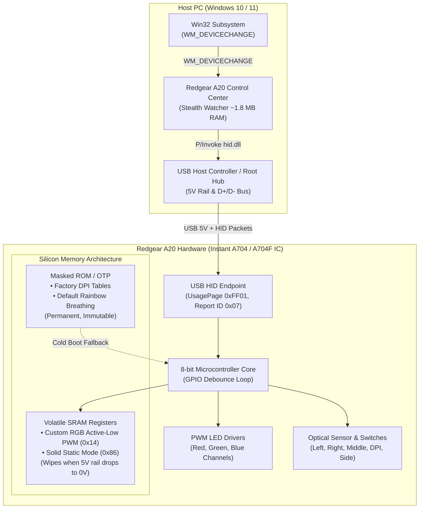

# 🏛️ Redgear A20 Control Center: Architecture, Decisions & Developer Guardrails

> **Target Audience**: Core developers, reverse engineers, and AI coding agents working on **v0.1.2**, **v0.2.0**, and future milestones.
> **Last Updated**: Release v0.1.1 (October 2026)
> **Target Device**: Redgear A20 RGB Gaming Mouse (`VID: 0x18F8`, `PID: 0x0FC0`)
> **Microcontroller**: Instant Microelectronics A704 / A704F USB Optical Gaming Mouse IC

---

## 📑 Table of Contents

1. [Executive Summary & Core Philosophy](#1-executive-summary--core-philosophy)
2. [Silicon & Hardware Architecture (The A704 Reality)](#2-silicon--hardware-architecture-the-a704-reality)
   - [Volatile SRAM vs. Masked ROM/OTP](#volatile-sram-vs-masked-romotp)
   - [The Truth About Command `0x20` (Sync Latch vs. Flash)](#the-truth-about-command-0x20-sync-latch-vs-flash)
   - [Why the Vendor Software Ran a Background Service](#why-the-vendor-software-ran-a-background-service)
3. [The Task Scheduler Event 410 Post-Mortem (Why It Failed)](#3-the-task-scheduler-event-410-post-mortem-why-it-failed)
4. [The Stealth Driver Watcher Architecture (The Proven Solution)](#4-the-stealth-driver-watcher-architecture-the-proven-solution)
   - [Native Win32 Message Pump (`WM_DEVICECHANGE`)](#native-win32-message-pump-wm_devicechange)
   - [Memory Compression via Working Set Trimming](#memory-compression-via-working-set-trimming)
   - [Cross-Session IPC & UIPI Bypass](#cross-session-ipc--uipi-bypass)
   - [Atomic Deployment Strategy](#atomic-deployment-strategy)
5. [Hardware Safety & Protocol Guardrails](#5-hardware-safety--protocol-guardrails)
   - [The GPIO Starvation Vulnerability (Buffer Overruns)](#the-gpio-starvation-vulnerability-buffer-overruns)
   - [Mandatory 50ms Inter-Packet Pacing](#mandatory-50ms-inter-packet-pacing)
   - [Ephemeral Handle Lifecycle](#ephemeral-handle-lifecycle)
   - [The Zero-Spam UI Rule](#the-zero-spam-ui-rule)
6. [Color, Dimming & DPI Math](#6-color-dimming--dpi-math)
   - [12-bit Active-Low PWM Register Encoding](#12-bit-active-low-pwm-register-encoding)
   - [Proportional Dimming Formula](#proportional-dimming-formula)
   - [Stage Iteration & Static Mode 0x86](#stage-iteration--static-mode-0x86)
   - [Experimental DPI Command 0x09](#experimental-dpi-command-0x09)
7. [Window Lifecycle & Exit Mechanics](#7-window-lifecycle--exit-mechanics)
   - [Window Close [X] vs. "Exit App" Button](#window-close-x-vs-exit-app-button)
   - [Accidental Termination Safeguards](#accidental-termination-safeguards)
8. [⛔ STRICT ANTI-PATTERNS: Things to NEVER Do in v0.1.2 / v0.2.0](#8--strict-anti-patterns-things-to-never-do-in-v012--v020)
9. [✅ SAFE ROADMAP: Safe Expansion Patterns for v0.1.2 & v0.2.0](#9--safe-roadmap-safe-expansion-patterns-for-v012--v020)
10. [🧪 Mandatory Pre-Flight Verification Checklist](#10--mandatory-pre-flight-verification-checklist)

---

## 1. Executive Summary & Core Philosophy

The **Redgear A20 Control Center** was created to replace the abandoned, bloated, and malfunctioning proprietary software (`Gaming Mouse 2.0.exe`) with a clean, high-performance, open-source utility inspired by **Logitech Onboard Memory Manager (OMM)** and **OpenRGB**.

### The Three Sacred Pillars of This Project:
1. **Zero External Dependencies**:
   - Single standalone `.exe` compiled with Windows' built-in .NET Framework C# compiler (`csc.exe`).
   - **No Visual Studio required**, no NuGet packages, no Electron, no WebView2, no Python runtime, no external C/C++ DLLs.
   - Must run out-of-the-box on a clean installation of Windows 10 or Windows 11 (64-bit).
2. **Hardware Safety Above All**:
   - Never risk bricking the mouse, saturating the microcontroller buffer, or causing input drops.
   - All experimental features must be isolated behind explicit opt-in checkboxes and tested in volatile RAM before committing.
3. **True Background Stealth (< 2 MB RAM, 0% CPU)**:
   - If a background process is required to compensate for hardware silicon limitations, it must be completely invisible (no system tray clutter, no taskbar button, near-zero RAM footprint, and 0.00% idle CPU).

---

## 2. Silicon & Hardware Architecture (The A704 Reality)

Understanding the silicon architecture of the mouse is essential to avoid repeating past mistakes.



### Volatile SRAM vs. Masked ROM/OTP
* **The Controller**: The Redgear A20 uses an **Instant Microelectronics A704 (or A704F)** optical gaming mouse chip (`VID: 0x18F8`, `PID: 0x0FC0`).
* **The Storage Discovery**:
  - The chip contains factory-programmed **Masked ROM / One-Time Programmable (OTP)** storage containing the default factory firmware: stock DPI tables (600, 1000, 1200, 1600, 2400, 3200) and default cyclic rainbow breathing lighting.
  - **The chip physically lacks onboard non-volatile EEPROM/Flash for custom RGB tables.**
  - Custom user RGB registers (programmed via Command `0x14` and mode byte `0x86`) are stored in **volatile SRAM**.
  - **Consequence**: The microsecond the USB $5\text{V}$ rail is cut (pulling the USB cable out, switching USB ports, PC shutdown, or cold power state), the volatile SRAM loses electrical charge and collapses. When power returns, the MCU bootloader boots from ROM, falling back to factory rainbow breathing.

### The Truth About Command `0x20` (Sync Latch vs. Flash)
* During reverse engineering of `Gaming Mouse 2.0.exe` at virtual address `0x004063A2`, Report `0x20` was labeled as a "Save" command.
* In initial versions, we assumed `0x20` wrote to physical EEPROM/Flash.
* **Forensic Reality**: Command `0x20` is an **internal hardware register synchronization latch**. It signals the MCU state machine to latch active staging registers into live PWM drivers. It returns Win32 `TRUE` (`HidD_SetFeature` succeeds), but because there is no non-volatile physical storage cell backing those registers, `0x20` **cannot survive cold electrical power loss**.

### Why the Vendor Software Ran a Background Service
* The original Redgear software (`Gaming Mouse 2.0.exe`) did not achieve hardware-level persistence.
* Instead, it ran an unoptimized background tray process that consumed $40\text{–}60\text{ MB}$ of RAM, queried devices, and reapplied the profile on startup.
* **Our Mission**: Achieve the exact same persistence outcome, but with a **featherweight, invisible Win32 watcher** (~1.8 MB RAM, 0% CPU, no system tray icon).

---

## 3. The Task Scheduler Event 410 Post-Mortem (Why It Failed)

During v0.1.1 development, the team attempted to achieve a 100% "Zero-RAM" solution without running any background process by utilizing Windows Task Scheduler Event Triggers:

```xml
<!-- ATTEMPTED EVENT TRIGGER (DO NOT USE) -->
<EventTrigger>
  <Subscription>
    &lt;QueryList&gt;
      &lt;Query Id="0" Path="Microsoft-Windows-Kernel-PnP/Configuration"&gt;
        &lt;Select Path="Microsoft-Windows-Kernel-PnP/Configuration"&gt;
          *[System[(EventID=410)]] and *[EventData[Data[@Name='DeviceInstanceId'] and (contains(., 'VID_18F8&amp;PID_0FC0'))]]
        &lt;/Select&gt;
      &lt;/Query&gt;
    &lt;/QueryList&gt;
  </Subscription>
</EventTrigger>
```

### Why Event 410 Failed:
1. **Windows PnP Event Logging Behavior**:
   - `Microsoft-Windows-Kernel-PnP/Configuration` Event `410` is **ONLY written upon initial device installation and driver configuration**.
   - When a user unplugs their mouse and replugs it into the same USB port, Windows executes a low-level PnP re-enumeration in `USBPORT.SYS` / `USBHUB3.SYS`.
   - **Windows kernel explicitly suppresses writing to `winevt` logs on normal hotplug** to prevent flash drive / peripheral hotplugging from causing excessive disk I/O churn.
2. **Testing Result**:
   - Cold boot: Task ran.
   - Hotplug replug / switching USB ports: **Event 410 never fired. The mouse fell back to rainbow breathing.**
3. **Decision**:
   - Task Scheduler EventTriggers were **permanently abandoned** for USB arrival detection.
   - Any legacy scheduled tasks named `RedgearA20_AutoApply` must be cleanly uninstalled via `schtasks /delete /tn RedgearA20_AutoApply /f`.

---

## 4. The Stealth Driver Watcher Architecture (The Proven Solution)

To solve hotplug persistence across all USB ports without user intervention, v0.1.1 introduced the **Stealth Driver Watcher**.

### Native Win32 Message Pump (`WM_DEVICECHANGE`)
* Windows broadcasts peripheral notifications exclusively via the Win32 window message system to top-level windows:
  ```csharp
  private const int WM_DEVICECHANGE = 0x0219;
  private const int DBT_DEVNODES_CHANGED = 0x0007;
  private const int DBT_DEVICEARRIVAL = 0x8000;
  private const int DBT_DEVICEREMOVECOMPLETE = 0x8004;
  ```
* **Top-Level Handle Requirement**: A message-only window (`HWND_MESSAGE`) does **NOT** receive broadcast `WM_DEVICECHANGE` messages in modern Windows. A standard top-level window handle is mandatory.
* **Invisible Window Pattern**:
  ```csharp
  protected override void SetVisibleCore(bool value)
  {
      if (startHidden && !isExplicitlyRestoring)
      {
          value = false;
          if (!this.IsHandleCreated) CreateHandle();
      }
      base.SetVisibleCore(value);
  }
  ```
  This creates the Win32 `HWND` and attaches it to the message pump without ever rendering a window frame on the user's desktop.

### Memory Compression via Working Set Trimming
Standard .NET Windows Forms applications consume $25\text{–}45\text{ MB}$ of memory due to JIT compilation structures and runtime metadata. 
To achieve our "Near-Zero RAM" promise:
```csharp
[DllImport("kernel32.dll")]
private static extern bool SetProcessWorkingSetSize(IntPtr proc, IntPtr min, IntPtr max);

private static void TrimMemory()
{
    try
    {
        GC.Collect();
        GC.WaitForPendingFinalizers();
        SetProcessWorkingSetSize(Process.GetCurrentProcess().Handle, new IntPtr(-1), new IntPtr(-1));
    }
    catch { }
}
```
* Passing `(-1, -1)` instructs the Windows Memory Manager to immediately trim the process working set, paging non-active framework structures out of physical RAM.
* **Result**: Working set drops from $\approx 45\text{ MB}$ to **$\approx 1.8\text{–}2.8\text{ MB}$**.
* **CPU Usage**: Because the process rests in a standard Win32 `GetMessage()` loop, it consumes **$0.00\%$ CPU** while waiting for hardware events.

### Cross-Session IPC & UIPI Bypass
If a user launches `RedgearA20-win-x64.exe` while the stealth watcher is already running:
1. **Single-Instance Mutex**:
   ```csharp
   appMutex = new Mutex(true, "RedgearA20ControlCenter_SingleInstance", out createdNew);
   ```
2. **Custom Registered Message**:
   ```csharp
   wmShowControlCenter = RegisterWindowMessage("RedgearA20_ShowControlCenter");
   ```
3. **UIPI Bypass (`ChangeWindowMessageFilter`)**:
   By default, Windows User Interface Privilege Isolation (UIPI) blocks window messages sent from lower integrity processes to elevated processes. We explicitly whitelist our message:
   ```csharp
   ChangeWindowMessageFilter(wmShowControlCenter, MSGFLT_ADD);
   ChangeWindowMessageFilter(WM_DEVICECHANGE, MSGFLT_ADD);
   ```
4. When a second instance launches:
   It detects `createdNew == false`, broadcasts `wmShowControlCenter` via `PostMessage(HWND_BROADCAST, ...)`, and exits instantly.
   The background stealth process catches `wmShowControlCenter`, calls `RestoreGui()`, and brings the control center to the front.

### Atomic Deployment Strategy
Users frequently run `RedgearA20-win-x64.exe` directly from their `Downloads` or `Desktop` folder. If they later delete or move that download, auto-start breaks.
* **Solution**: On save, the application auto-deploys itself to `%LocalAppData%\RedgearA20\RedgearA20.exe`.
* **Atomic Move-Away Rename**:
  If the destination file is locked by a running instance, direct `File.Copy(..., overwrite: true)` throws `IOException: Sharing violation`.
  We resolve this using Windows' file-system behavior: **a running executable cannot be overwritten, but it CAN be renamed**:
  ```csharp
  string oldPath = targetPath + ".old";
  try { if (File.Exists(oldPath)) File.Delete(oldPath); } catch { }
  if (File.Exists(targetPath))
  {
      File.Move(targetPath, oldPath);
  }
  File.Copy(currentExe, targetPath, true);
  ```

---

## 5. Hardware Safety & Protocol Guardrails

Interfacing directly with budget microcontrollers carries real risks of hardware lockups. Adhere strictly to these rules:

### The GPIO Starvation Vulnerability (Buffer Overruns)
* **The Architecture Vulnerability**:
  - The Instant A704 MCU processes optical sensor reads (SPI) and scroll wheel ticks via hardware interrupts.
  - **Button switches (Left, Right, Middle, DPI, Forward, Back) are scanned via software in a firmware GPIO debounce loop on the MCU's main thread.**
* **What Happens if You Spam the Device**:
  If the host software transmits back-to-back HID Feature Reports without pacing, the MCU's 8-bit USB FIFO buffer overflows. The microcontroller gets trapped servicing USB buffer interrupts, starving the GPIO debounce scan loop.
* **The Symptom**: The mouse sensor continues tracking movement smoothly, but **all physical clicks stop responding completely**. The user is locked out until the mouse is physically unplugged.

### Mandatory 50ms Inter-Packet Pacing
* Every multi-packet dispatch sequence **MUST** enforce a minimum of **$50\text{ms}$ delay between individual 8-byte Feature Reports**:
  ```csharp
  Thread.Sleep(50); // MANDATORY: Prevents A704 endpoint FIFO saturation
  ```
* Under no circumstances may this delay be reduced or removed.

### Ephemeral Handle Lifecycle
* **Never maintain an open `SafeFileHandle` to the HID device.**
* Holding an open handle locks the endpoint in Windows `hidclass.sys`, causing subsequent instances or sleep/wake handlers to receive `ERROR_ACCESS_DENIED (5)`.
* **The Safe Pattern**:
  1. Open handle with `CreateFile(devicePath, GENERIC_READ | GENERIC_WRITE, FILE_SHARE_READ | FILE_SHARE_WRITE, ...)`.
  2. Transmit report with `HidD_SetFeature()`.
  3. Flush buffer with `HidD_FlushQueue(handle)`.
  4. Dispose/Close handle immediately.

### The Zero-Spam UI Rule
* **TrackBars and Color Pickers must NEVER trigger USB dispatches during user interaction.**
* Sliders only update the local on-screen visual preview panel (`UpdateColorPreview()`).
* USB packets are **ONLY** transmitted upon an explicit user click on:
  - `[ ▶ Apply to Mouse (RAM) ]`
  - `[ 💾 Save Profile ]`
  - `[ ↺ Reset Profile ]`
  - `[ Test DPI (RAM) ]`

---

## 6. Color, Dimming & DPI Math

### 12-bit Active-Low PWM Register Encoding
The Instant A704 uses **Active-Low PWM** logic for its LED drivers:
* Value `0x0` ($0$) = $100\%$ Duty Cycle (Full Brightness)
* Value `0xF` ($15$) = $0\%$ Duty Cycle (Completely Off)

Each color channel (R, G, B) has 4 bits of precision ($0\text{–}15$ steps), yielding $16^3 = 4,096$ colors.

### Proportional Dimming Formula
To dim the brightness without shifting the color hue:
$$\text{Scale} = \frac{\text{BrightnessPercent}}{100.0}$$
$$\text{rStep} = \text{clamp}\left(0, 15, \text{round}\left(\frac{R}{255} \times \text{Scale} \times 15\right)\right)$$
$$\text{gStep} = \text{clamp}\left(0, 15, \text{round}\left(\frac{G}{255} \times \text{Scale} \times 15\right)\right)$$
$$\text{bStep} = \text{clamp}\left(0, 15, \text{round}\left(\frac{B}{255} \times \text{Scale} \times 15\right)\right)$$

Then invert for Active-Low hardware:
$$\text{rInv} = (15 - \text{rStep}) \ \& \ 0\text{x0F}$$
$$\text{gInv} = (15 - \text{gStep}) \ \& \ 0\text{x0F}$$
$$\text{bInv} = (15 - \text{bStep}) \ \& \ 0\text{x0F}$$

### Stage Iteration & Static Mode 0x86
1. **Command `0x14` (Color per Stage)**:
   The A704 assigns colors per DPI stage ($0\text{–}5$). To achieve a consistent single static color, Command `0x14` is transmitted across all 6 stages:
   ```csharp
   byte b2 = (byte)(((stage & 0x07) << 5) | (gInv & 0x0F));
   byte b3 = (byte)(((rInv & 0x0F) << 4) | (bInv & 0x0F));
   byte[] packet = new byte[] { 0x07, 0x14, b2, b3, 0x00, 0x00, 0x00, 0x00 };
   ```
2. **Command `0x13` (Solid Static Mode)**:
   Forces the lighting mode from factory breathing (`0x80`) to static solid:
   ```csharp
   byte[] modePacket = new byte[] { 0x07, 0x13, 0x7F, 0x86, 0x00, 0x00, 0x00, 0x00 };
   ```

### Experimental DPI Command 0x09
Configures active DPI stage and enabled bitmask:
```csharp
byte b2 = (byte)(0x40 | (stageIndex & 0x07));
byte[] dpiPacket = new byte[] { 0x07, 0x09, b2, 0x08, 0x3F, 0x00, 0x00, 0x00 };
```
* `b2`: `0x40` (Stage 0: 600 DPI) through `0x45` (Stage 5: 3200 DPI).
* `b4`: `0x3F` (`00111111b`) keeps all 6 stages active in the hardware cycle.

---

## 7. Window Lifecycle & Exit Mechanics

### Window Close [X] vs. "Exit App" Button
* **Windows Close `[X]` Button**:
  - `OnFormClosing` intercepts the event.
  - Calls `MinimizeToWatcher()`, hiding the window and trimming memory to ~1.8 MB RAM.
  - **The persistence facility stays active.** The mouse settings will continue auto-applying on reconnect or reboot.
* **Top Header "Exit App" Button**:
  - Completely terminates the process (`isExiting = true; Application.Exit()`).
  - **Stops the persistence watcher.**

### Accidental Termination Safeguards
Because terminating the process stops hotplug persistence, `btnExit` displays a prominent warning dialog:
1. **High-Visibility Warning**: Explains explicitly that exiting terminates background persistence and reverts the mouse to factory rainbow on disconnect.
2. **Recommends [X] Button**: Suggests clicking "No" and closing via `[X]` if the user merely wanted to close the window.
3. **Default to "No" (`MessageBoxDefaultButton.Button2`)**: If the user hits `Enter` or `Space` reflexively, it selects "No" to avoid accidental shutdown.

---

## 8. ⛔ STRICT ANTI-PATTERNS: Things to NEVER Do in v0.1.2 / v0.2.0

> [!CAUTION]
> The following actions were intentionally avoided or eliminated after rigorous testing. **DO NOT REINTRODUCE THEM.**

1. ❌ **NEVER add external NuGet packages or third-party DLL dependencies.**
   - Do NOT add `Newtonsoft.Json`, `HidLibrary`, `Costura.Fody`, or UI skin frameworks.
   - The project's strength is its pure zero-dependency compilation via `csc.exe`. Any JSON parsing needed must be handled via regex or native string helpers.
2. ❌ **NEVER remove the 50ms inter-packet delay.**
   - Removing or lowering `Thread.Sleep(50)` will saturate the Instant A704's endpoint FIFO buffer and lock up physical mouse clicks.
3. ❌ **NEVER transmit USB packets during slider drag events.**
   - Live dragging triggers dozens of packets per second. It causes micro-stuttering on the USB bus and risks MCU buffer stalls.
4. ❌ **NEVER hold persistent open HID file handles.**
   - Always open, transmit, flush, and close immediately.
5. ❌ **NEVER attempt to flash OTP memory addresses.**
   - Do not attempt random write commands or fuzz command IDs outside `0x07, 0x09, 0x11, 0x13, 0x14, 0x15, 0x16, 0x20`. Fuzzing undocumented addresses on OTP chipsets can corrupt internal state pointers.
6. ❌ **NEVER revert to Windows Task Scheduler Event Triggers for USB detection.**
   - As proven in Section 3, Windows Event Log does not record Event 410 on normal runtime USB hotplugging.
7. ❌ **NEVER bind Left Click or Right Click to unverified actions.**
   - In Milestone 4 (Button Remapping), Left Click (`Button 1`) and Right Click (`Button 2`) must have **hardcoded UI locks** preventing them from being unmapped, disabled, or bound to invalid registers.
8. ❌ **NEVER require Administrator privileges for basic operation.**
   - Standard user mode is sufficient for HID Feature Reports on vendor collections (`UsagePage 0xFF01`). Requiring elevation annoys users and triggers unnecessary UAC prompts on every reboot.
9. ❌ **NEVER remove the hardware mutex lock (`Local\RedgearA20_HardwareLock`).**
   - The hardware mutex prevents concurrent dispatches from corrupting multi-packet sequences if a hotplug event fires while the GUI is actively saving.
10. ❌ **NEVER overwrite `%LocalAppData%\RedgearA20\RedgearA20.exe` without the atomic move-away pattern.**
    - Direct overwriting of a running binary causes `IOException (Sharing Violation)`. Always use `.old` renaming.

---

## 9. ✅ SAFE ROADMAP: Safe Expansion Patterns for v0.1.2 & v0.2.0

### Safe Scope for v0.1.2 (Maintenance & Polish)
* [x] Enhanced Exit Confirmation Dialog with prominent persistence warnings.
* [ ] Expanded quick color preset buttons (e.g. Amber, Coral, Deep Ocean, Emerald).
* [ ] Diagnostic log copy formatting options (Markdown / Plain Text).
* [ ] System tray icon tooltip enhancements showing active DPI and color.

### Safe Scope for v0.2.0 (Extended Lighting Engine)
* **Breathing Modes (`0x80`–`0x85`)**:
  - Expose hardware breathing mode byte with user-selectable cycle speeds:
    - `0x80`: Slow Pulse (~6s cycle)
    - `0x81`: Medium-Slow Pulse (~4.5s cycle)
    - `0x82`: Medium Pulse (~3s cycle)
    - `0x83`: Medium-Fast Pulse (~2s cycle)
    - `0x84`: Fast Pulse (~1.2s cycle)
    - `0x85`: Rapid Pulse (~0.8s cycle)
  - Safe pattern: Transmit `[0x07, 0x13, 0x7F, SpeedByte, 0x00, 0x00, 0x00, 0x00]`.
* **Cyclic Spectrum Modes (`0x90`–`0x95`)**:
  - Expose hardware full-spectrum cycle modes with speed control.
* **Instant Stealth / LED Off (`0x87`)**:
  - Safe pattern: Transmit `[0x07, 0x13, 0x7F, 0x87, 0x00, 0x00, 0x00, 0x00]`.
* **Named Lighting Profiles (Local JSON)**:
  - Allow users to export/import `.json` profiles to `%LocalAppData%\RedgearA20\profiles\`.
  - Parse safely with internal regex/string parsing (zero NuGet dependencies).

---

## 10. 🧪 Mandatory Pre-Flight Verification Checklist

Before publishing any future release (`v0.1.2`, `v0.2.0`, etc.), the following manual verification battery **MUST** be performed:

- [ ] **Clean Build**: `build.bat` executes with 0 errors and 0 warnings using `csc.exe`.
- [ ] **Binary Size**: Executable remains under $100\text{ KB}$ (currently $\approx 63.5\text{ KB}$).
- [ ] **Physical Click Test**: After clicking "Apply" and "Save", verify physical Left, Right, and Middle clicks respond immediately without latency or input drop.
- [ ] **Hotplug Verification**:
  1. Save custom color (e.g. Lavender `#BE59FF`).
  2. Unplug mouse from USB port $\rightarrow$ mouse powers off.
  3. Replug mouse into the same port $\rightarrow$ verifies color restores within $500\text{ms}$.
  4. Unplug mouse and plug into a **different** USB port/hub $\rightarrow$ verifies color restores.
- [ ] **Reboot / Wake Verification**:
  - Restart PC $\rightarrow$ verify background watcher starts and applies settings without opening any GUI window.
- [ ] **Memory Audit**:
  - Check Windows Task Manager: `RedgearA20.exe` working set must remain $\le 3.0\text{ MB}$ RAM and $0.00\%$ CPU when idle.
- [ ] **Single Instance IPC**:
  - With stealth watcher running, double-click `release\RedgearA20-win-x64.exe` $\rightarrow$ verifies GUI restores smoothly without duplicate processes.
- [ ] **Checksum Matching**:
  - Verify `release\RedgearA20-win-x64.sha256` exactly matches `Get-FileHash release\RedgearA20-win-x64.exe`.
