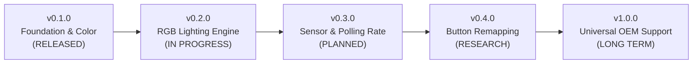

# 🗺️ Project Roadmap: Redgear A20 Control Center

This document outlines the development milestones, planned features, and architectural direction for the **Redgear A20 Control Center** project.

---

## 🎯 Project Vision & Guiding Principles

The official Redgear software is abandoned, bloated, and unstable. Our goal is to provide a clean, high-performance hardware utility inspired by tools like **Logitech Onboard Memory Manager (OMM)** and **OpenRGB**:

1. **Zero-Bloat & Portable**: Single standalone executable ($<30\text{ KB}$), zero background services, zero electron wrappers, zero network telemetry.
2. **Hardware-First**: Directly communicate with mouse microcontroller registers via native USB HID Feature Reports.
3. **Safety First**: Never spam device buffers, decouple volatile RAM testing from flash writes, and safeguard core input switches against lockups.

---

## 📍 Release Milestones

---

### ✅ Milestone 1: v0.1.0 — Core Lighting & Safety Architecture (Current Release)
- [x] Full reverse engineering of `Gaming Mouse 2.0.exe` and endpoint collection detection (`UsagePage 0xFF01`).
- [x] **12-bit Active-Low PWM Color Engine**: 4,096 discrete hardware colors ($16 \times 16 \times 16$).
- [x] **Proportional Brightness Dimming**: Continuous scaling ($5\text{–}100\%$) while preserving exact color hue.
- [x] **Solid Static Mode (`0x86`)**: Eliminated unchangeable vendor rainbow breathing.
- [x] **Hardened Safety Guardrails**: RAM-only live preview, isolated EEPROM save button, mandatory 50ms hardware delays, and zero-spam slider mechanics.
- [x] **Live Hex Packet Inspector**: Real-time diagnostic console displaying all 8-byte Feature Reports.
- [x] **Zero-Dependency Native WinForms GUI**: Standalone 64-bit executable (`RedgearA20-win-x64.exe`) and 1-click build script.

---

### ⏳ Milestone 2: v0.2.0 — Extended RGB Effects & Lighting Engine
*Target: Q4 2026*

- [ ] **Configurable Breathing Mode**:
  - Expose hardware modes `0x80` through `0x85` with selectable cycle periods (slow pulse to fast pulse).
- [ ] **Cyclic Spectrum Mode**:
  - Expose hardware modes `0x90` through `0x95` with customizable rotation speeds.
- [ ] **Instant LED Off / Stealth Mode**:
  - Hardware mode `0x87` to completely disable mouse lighting with one click.
- [ ] **Named Color Profile System**:
  - Save, load, and share custom lighting presets via lightweight JSON files (`Valorant.json`, `NightMode.json`, `Work.json`).
- [ ] **Auto-Sleep / Idle Dimming (Optional)**:
  - Detect system idle time and gently dim lighting after $N$ minutes of inactivity, instantly restoring upon movement.

---

### ⏳ Milestone 3: v0.3.0 — Sensor, Polling Rate & Memory Persistence
*Target: Q1 2027*

- [ ] **EEPROM Cold-Boot Persistence (`0x20`)**:
  - Solve the cold-reboot flash commit sequence (investigating potential pre-commit unlock bytes such as `0x5A 0xA5` observed in packet analysis) so custom settings survive full power unplugging across all hardware revisions.
- [ ] **DPI Stage Pruning (Command `0x09`)**:
  - Enable players to reduce the default 6 DPI stages down to 2 or 3 active stages using the hardware bitmask, eliminating redundant DPI cycling during competitive matches.
- [ ] **Independent DPI Stage Color Tagging**:
  - Assign distinct colors per DPI stage (e.g. Stage 1 = Lavender, Stage 2 = Cyan, Stage 3 = Crimson Red).
- [ ] **Hardware USB Polling Rate Selector (Command `0x11`)**:
  - Safe UI control for $125\text{Hz}$, $250\text{Hz}$, $500\text{Hz}$, and $1000\text{Hz}$ switching.

---

### 🔬 Milestone 4: v0.4.0 — Hardware Button Remapping (Experimental)
*Target: Mid 2027*

- [ ] **Side Button Customization (Command `0x15` / `0x16`)**:
  - Safely rebind Button 4 (Forward) and Button 5 (Back) to custom actions (Middle Click, Media Play/Pause, Mute, Volume Control).
- [ ] **Hardware Fail-Safe Interlock**:
  - Ensure Left Click and Right Click bindings are strictly locked against accidental unbinding or invalid register values to prevent device input lockouts.
- [ ] **Sniper / DPI Clutch Mode**:
  - Temporary sensitivity drop while holding a designated side button.

---

### 🌐 Milestone 5: v1.0.0 — Multi-Device & Community Profiles
*Target: Late 2027*

- [ ] **Device Profile Abstraction**:
  - Modular device definition layer allowing support for other budget gaming mice powered by Instant Microelectronics, SinoWealth, or Holtek chipsets.
- [ ] **Community Device Contribution Guide**:
  - Step-by-step documentation for users to submit USB HID descriptors and packet captures for new devices.
- [ ] **Portable MSIX / Single-File Release Pipeline**:
  - Automated GitHub Actions build and release packaging.

---

## 🚫 Out of Scope (Explicit Non-Goals)

To preserve the utility's lightweight nature and protect mouse hardware, the following are explicitly out of scope:

* **No Background Telemetry or Mandatory Accounts**: We will never require logins, cloud syncing, or background analytic daemons.
* **No Multi-Zone Addressable ARGB**: The Redgear A20 uses a single diffused hardware LED zone; multi-zone wave animations do not physically exist on this PCB.
* **No Firmware Overclocking beyond $1000\text{Hz}$**: The OEM microcontroller operates at Full-Speed USB 2.0 ($1000\text{Hz}$ max); pushing higher packet frequencies risks input desynchronization.
